<p align="center">
  
</p>

<p align="center">
  <a href="https://github.com/ishandutta2007/Awesome-Awesome-Awesome"></a>
  <a href="https://discord.gg/jc4xtF58Ve"></a>
  <a href="https://github.com/ishandutta2007/Awesome-Service-Mesh/stargazers"></a>
  <a href="https://github.com/ishandutta2007/Awesome-Service-Mesh/network/members"></a>
  <a href="https://github.com/ishandutta2007/Awesome-Service-Mesh/issues"></a>
  <a href="https://github.com/ishandutta2007/Awesome-Service-Mesh/blob/main/LICENSE"></a>
  <a href="https://github.com/ishandutta2007"></a>
</p>

---

# 🚀 Awesome Service Mesh &amp; Service Proxies

> A comprehensive, production-grade, curated collection of **Service Meshes**, **Layer 4/7 Service Proxies**, **Ingress Controllers**, and **Cloud-Native API Gateways**. Designed for Site Reliability Engineers (SREs), Platform Architects, and DevOps teams building resilient, secure, and observable distributed microservice architectures.

---

## 📑 Table of Contents
- [🌐 Sector Overview &amp; Market Dynamics](#-sector-overview--market-dynamics)
- [🏢 SaaS &amp; Commercial Application Delivery Platforms](#-saas--commercial-application-delivery-platforms)
- [🔓 Open-Source GitHub Projects](#-open-source-github-projects)
- [🔬 Architectural Paradigms: Sidecar vs. Ambient vs. eBPF](#-architectural-paradigms-sidecar-vs-ambient-vs-ebpf)
- [⚡ Engineering Performance &amp; Benchmark Insights](#-engineering-performance--benchmark-insights)
- [🤝 How to Contribute](#-how-to-contribute)
- [⭐ Star History](#-star-history)
- [☕ Support &amp; Community](#-support--community)
- [⚠️ Disclaimer](#️-disclaimer)

---

## 🌐 Sector Overview &amp; Market Dynamics

The global **Service Mesh and Application Delivery Controller (ADC) / Cloud API Gateway market** was valued at approximately **$4.8 Billion in 2024** and is projected to surge past **$14.2 Billion by 2030**, compounding at an aggressive **CAGR of ~23.5%**. This explosive expansion is propelled by enterprise microservice sprawl, strict Zero-Trust security mandates (mutual TLS by default), and the emergence of high-throughput AI/LLM inference routing requiring token-aware streaming reverse proxies.

In terms of structure, the sector exhibits **bifurcated market dynamics**:
- **Commercial Edge &amp; Cloud ADC (Highly Concentrated)**: Dominated by hyperscalers (**AWS**, **Cloudflare**, **Microsoft Azure**) and legacy infrastructure powerhouses (**F5**, **Citrix / Cloud Software Group**), which capture upwards of 70% of high-contract enterprise networking budgets with bundled SLAs and global edge networks.
- **Developer Data Plane &amp; Service Mesh (Moderately Fragmented)**: Highly dynamic open-source competition where **Envoy Proxy**, **Istio**, **Traefik**, **Caddy**, and **Cilium (eBPF)** compete fiercely for platform mindshare. Platform teams increasingly combine best-of-breed open data planes (Envoy/eBPF) with commercial managed control planes (Kong Konnect, Solo.io Gloo) to eliminate vendor lock-in while preserving enterprise manageability.

---

## 🏢 SaaS &amp; Commercial Application Delivery Platforms

The following commercial solutions provide fully managed infrastructure, global server load balancing (GSLB), enterprise Web Application Firewalls (WAF), and centralized multi-cluster management. **Sorted by Company Size / Valuation (Descending):**

| 🏢 Platform / Vendor | 💰 Valuation / Revenue | 🏷️ Starting Pricing | 🎁 Free Tier &amp; Free Trial Limits | 🛠️ Core Capabilities &amp; Best For |
| :--- | :--- | :--- | :--- | :--- |
| **[AWS Application &amp; Network Load Balancer](https://aws.amazon.com/elasticloadbalancing/)** | **~$2.1 Trillion** (Market Cap) / ~$105B+ AWS ARR | **$0.0225/hr** base + **$0.008/LCU-hr** (~$16.20/mo base for ALB); **$0.006/NLCU-hr** for NLB | **750 hours/month** shared between ALB/CLB + 15 LCUs free for 12 months on AWS Free Tier | Fully managed Layer 7 HTTP/HTTPS path routing &amp; Layer 4 ultra-low latency TCP/UDP load balancing with AWS ACM &amp; WAF integration. |
| **[Cloudflare Load Balancing](https://www.cloudflare.com/application-services/products/load-balancing/)** | **~$38.5 Billion** (Market Cap) / ~$1.6B+ ARR | **$5.00/month** (includes 2 origin servers; +$0.50 per 500,000 queries beyond quota) | **Free Forever Plan** includes global CDN, DDoS protection &amp; SSL; Load Balancing has **30-day free trial** with full DNS steering | Anycast-powered Global Server Load Balancing (GSLB), multi-region failover, and instantaneous geo-steering at the network edge. |
| **[Citrix ADC / NetScaler](https://www.netscaler.com/)** | **~$16.5 Billion** (Acquisition Valuation) / ~$3.2B+ ARR | **$15,000** perpetual (VPX-200, 200 Mbps) or **$2,400/yr** subscription (~$0.44/hr cloud marketplace) | **NetScaler Express Free Forever** (capped at 20 Mbps throughput and 2 virtual servers) &amp; **90-day trial** for VPX enterprise | Enterprise Application Delivery Controller (ADC) with advanced content switching, AppExpert policy engine, and Citrix VDI acceleration. |
| **[F5 BIG-IP](https://www.f5.com/products/big-ip-services)** | **~$15.2 Billion** (Market Cap) / ~$2.8B+ Annual Revenue | **$6,146** perpetual (VE-200M license) or **$0.45/hr** utility billing on AWS/Azure Marketplace | **30-day fully functional trial** of BIG-IP Virtual Edition (VE) with up to 25 Mbps bandwidth cap for lab evaluation | Hardware and virtual ADC market leader featuring advanced Layer 4-7 traffic shaping, hardware SSL offloading, and Advanced WAF. |
| **[NGINX Plus](https://www.nginx.com/products/nginx/)** | **~$15.2 Billion** (F5 Parent Cap) / ~$150M+ ARR division | **$3,450/instance per year** (Basic tier subscription) or **$0.35/hr** via AWS/Azure Marketplace | **30-day unrestricted free trial** license including active health checks, dynamic reconfiguration, and real-time live monitoring dashboard | Commercial distribution of NGINX offering dynamic upstream updates via API, session persistence, JWT validation, and enterprise SLAs. |
| **[Kemp LoadMaster](https://kemptechnologies.com/)** | **~$2.8 Billion** (Progress Software Cap) / ~$750M+ Revenue | **$2,400** one-time perpetual (VLM-MAX) or **$840/year** subscription ($70/month) | **Free LoadMaster Edition** (perpetual free license capped at 20 Mbps with Layer 7 proxy) &amp; **30-day full enterprise trial** | Cost-effective ADC featuring integrated Web Application Firewall (WAF), edge pre-authentication, and global server traffic management. |
| **[Kong Konnect](https://konghq.com/products/kong-konnect)** | **~$2.0 Billion** (Series E Valuation) / ~$120M+ ARR | **$250/month** (Team Tier, includes 3 control planes &amp; 5 data planes; $0.20 per 100k calls overage) | **Free Forever Tier**: 1 serverless control plane, up to 3 services, and 1,000,000 API requests/month with no credit card required | Enterprise cloud-managed control plane orchestrating distributed Kong Gateway and Kong Mesh deployments with unified API catalog. |
| **[Fastly Next-Gen WAF &amp; Load Balancing](https://www.fastly.com/products/load-balancing)** | **~$1.2 Billion** (Market Cap) / ~$540M+ Revenue | **$50.00/month** starter package + consumption ($0.12/GB bandwidth + $0.75 per 10,000 requests) | **$50 free testing credit** (up to 30 days) with instant provisioning, real-time edge streaming logs, and origin pooling | Programmable edge cloud proxy with sub-millisecond origin failover, instant cache purging, and WebAssembly-based Compute@Edge execution. |
| **[Solo.io Gloo Mesh &amp; Gateway](https://www.solo.io/products/gloo-mesh/)** | **~$1.0 Billion** (Series C Valuation) / ~$60M+ ARR | **$1,200/node per year** (~$100/node/month for Gloo Mesh Core) or custom multi-cluster package | **30-day full-featured free enterprise trial** including multi-cluster Istio orchestration, Cilium CNI integration, and Gloo UI | Enterprise Istio and Envoy orchestration platform providing unified zero-trust mTLS, multi-cluster federation, and GraphQL edge routing. |

---

## 🔓 Open-Source GitHub Projects

Curated open-source service meshes, L4/L7 service proxies, ingress controllers, and API gateways. **Sorted by GitHub Stars (Descending):**

### 1. [Caddy](https://github.com/caddyserver/caddy) [](https://github.com/caddyserver/caddy/stargazers)
* **GitHub Stars**: ~78,000+ | **License**: Apache-2.0 | **Primary Language**: Go
* **Architecture**: Modular, memory-safe web server and reverse proxy with native HTTP/1.1, HTTP/2, and HTTP/3 support.
* **Key Features**: **Automatic HTTPS by default** via Let's Encrypt / ZeroSSL, dynamic JSON configuration API, human-readable Caddyfile format, active and passive health checking, and zero-downtime config reloads.
* **Best For**: Developers seeking zero-effort TLS management and fast reverse proxying for standalone hosts or lightweight container stacks.

### 2. [Traefik](https://github.com/traefik/traefik) [](https://github.com/traefik/traefik/stargazers)
* **GitHub Stars**: ~65,200+ | **License**: MIT | **Primary Language**: Go
* **Architecture**: Event-driven cloud-native reverse proxy and ingress controller with real-time dynamic service discovery.
* **Key Features**: Auto-discovers routing rules from Docker, Kubernetes CRDs / Gateway API, Consul, and etcd without service restarts. Built-in Let's Encrypt automation (including wildcard certificates), circuit breakers, canary deployments, and visual dashboard.
* **Best For**: Microservice platforms and Kubernetes clusters that scale dynamically and require zero-touch route configuration.

### 3. [Kong Gateway OSS](https://github.com/Kong/kong) [](https://github.com/Kong/kong/stargazers)
* **GitHub Stars**: ~44,200+ | **License**: Apache-2.0 | **Primary Language**: Lua / OpenResty / C
* **Architecture**: High-performance API Gateway and AI Gateway built on NGINX and LuaJIT.
* **Key Features**: Sub-millisecond routing latency, 95+ community and official plugins (OIDC, rate limiting, HMAC, Prometheus, Datadog), AI gateway routing with token-aware rate limiting, and GitOps-ready declarative configuration via `decK`.
* **Best For**: Enterprise API management, developer portals, and microservice traffic mediation requiring an extensive plugin catalog.

### 4. [Istio](https://github.com/istio/istio) [](https://github.com/istio/istio/stargazers)
* **GitHub Stars**: ~38,400+ | **License**: Apache-2.0 | **CNCF Graduated** | **Primary Language**: Go / C++
* **Architecture**: Enterprise-grade service mesh utilizing Envoy as sidecars or Istio Ambient (sidecarless ztunnel L4 / waypoint L7) data plane.
* **Key Features**: Transparent mutual TLS (mTLS) with SPIFFE/SPIRE cryptographic identities, rich traffic shifting (canary, blue-green, A/B), fault injection, distributed tracing (OpenTelemetry, Jaeger), and Kubernetes Gateway API integration.
* **Best For**: Large-scale multi-cluster Kubernetes deployments requiring rigorous Zero-Trust compliance and advanced traffic steering.

### 5. [Nginx Proxy Manager](https://github.com/NginxProxyManager/nginx-proxy-manager) [](https://github.com/NginxProxyManager/nginx-proxy-manager/stargazers)
* **GitHub Stars**: ~34,400+ | **License**: MIT | **Primary Language**: JavaScript / Python / NGINX
* **Architecture**: Containerized NGINX reverse proxy with a responsive, user-friendly Web UI.
* **Key Features**: Point-and-click reverse proxy creation, free automatic SSL certificate generation via Let's Encrypt, HTTP/2 support, basic authentication access lists, and custom NGINX configuration snippets.
* **Best For**: Home labs, small office networks, and developers seeking an easy visual control panel for reverse proxy management.

### 6. [NGINX Open Source](https://github.com/nginx/nginx) [](https://github.com/nginx/nginx/stargazers)
* **GitHub Stars**: ~31,800+ | **License**: BSD-2-Clause | **Primary Language**: C
* **Architecture**: Asynchronous, event-driven, single-threaded master-worker architecture.
* **Key Features**: Industry-standard HTTP/1.1, HTTP/2, HTTP/3, and TCP/UDP stream reverse proxying; robust static content caching; gzip and Brotli compression; and Lua/njs scripting capabilities.
* **Best For**: High-concurrency web serving, static edge caching, and predictable Layer 4/7 reverse proxying with minimal memory overhead.

### 7. [Consul](https://github.com/hashicorp/consul) [](https://github.com/hashicorp/consul/stargazers)
* **GitHub Stars**: ~30,000+ | **License**: BSL / MPL-2.0 | **Primary Language**: Go
* **Architecture**: Multi-datacenter service discovery, distributed key-value store, and service mesh.
* **Key Features**: Real-time service health checking, dynamic DNS interface, automated mTLS service-to-service communication with intentions-based RBAC, and seamless multi-cloud federation across VMs and Kubernetes.
* **Best For**: Hybrid infrastructures spanning bare metal, traditional virtual machines, and container clusters.

### 8. [Envoy Proxy](https://github.com/envoyproxy/envoy) [](https://github.com/envoyproxy/envoy/stargazers)
* **GitHub Stars**: ~29,000+ | **License**: Apache-2.0 | **CNCF Graduated** | **Primary Language**: C++
* **Architecture**: High-performance, low-footprint L4/L7 proxy and communication bus designed for modern service-oriented architectures.
* **Key Features**: Dynamic configuration via xDS APIs (LDS, RDS, CDS, EDS), first-class HTTP/2 and gRPC support, advanced load balancing (zone-aware, consistent hashing), deep observability, WebAssembly (Wasm) filter extensions, and native AI/LLM streaming token rate limiting.
* **Best For**: Cloud-native data planes, foundation for custom API gateways, and sidecar proxies in Kubernetes service meshes.

### 9. [Cilium Service Mesh](https://github.com/cilium/cilium) [](https://github.com/cilium/cilium/stargazers)
* **GitHub Stars**: ~25,600+ | **License**: Apache-2.0 | **CNCF Graduated** | **Primary Language**: Go / C (eBPF)
* **Architecture**: eBPF-powered networking, security, observability, and sidecarless service mesh.
* **Key Features**: Replaces kube-proxy with kernel-level eBPF routing; enforces Layer 3 to Layer 7 network security policies; terminates TLS at the kernel socket layer; and provides sidecar-free ingress and service mesh capabilities with zero pod injection overhead.
* **Best For**: High-throughput, latency-critical Kubernetes clusters where sidecar resource taxation and hop latencies cannot be tolerated.

### 10. [Apache APISIX](https://github.com/apache/apisix) [](https://github.com/apache/apisix/stargazers)
* **GitHub Stars**: ~17,200+ | **License**: Apache-2.0 | **ASF Top-Level** | **Primary Language**: Lua / Go
* **Architecture**: Cloud-native API gateway built on NGINX and OpenResty, utilizing etcd for distributed configuration consensus.
* **Key Features**: Dynamic routing and hot-reloading without service restarts, multi-language plugin runners (Go, Python, Java, Wasm), automated gRPC-to-JSON transcoding, and out-of-the-box OpenTelemetry integration.
* **Best For**: Enterprise teams seeking open governance under the Apache Software Foundation with dynamic etcd-backed routing.

### 11. [Linkerd2](https://github.com/linkerd/linkerd2) [](https://github.com/linkerd/linkerd2/stargazers)
* **GitHub Stars**: ~11,500+ | **License**: Apache-2.0 | **CNCF Graduated** | **Primary Language**: Rust / Go
* **Architecture**: Ultralight, security-first service mesh engineered explicitly for Kubernetes.
* **Key Features**: Ultra-fast, memory-safe data plane (`linkerd2-proxy`) written in Rust; zero-configuration mutual TLS (mTLS); sub-millisecond p99 latency overhead; automatic retry and timeout budgets; and instant Golden Metrics (success rate, latency, throughput).
* **Best For**: Teams demanding production simplicity, memory safety, and minimal operational overhead without complex CRD sprawl.

### 12. [Tyk Gateway](https://github.com/TykTechnologies/tyk) [](https://github.com/TykTechnologies/tyk/stargazers)
* **GitHub Stars**: ~10,800+ | **License**: MPL-2.0 | **Primary Language**: Go
* **Architecture**: Independent, battery-included API Gateway written from scratch in Go.
* **Key Features**: Native REST, GraphQL, and gRPC engine with zero third-party web server dependencies; built-in quota management, rate limiting, token authentication, and JavaScript / Python / Go middleware plugins.
* **Best For**: Organizations prioritizing pure Go deployments, unified GraphQL federation, and multi-tenant developer portals.

### 13. [MetalLB](https://github.com/metallb/metallb) [](https://github.com/metallb/metallb/stargazers)
* **GitHub Stars**: ~8,300+ | **License**: Apache-2.0 | **Primary Language**: Go
* **Architecture**: Bare-metal network load-balancer implementation for Kubernetes clusters.
* **Key Features**: Enables `type: LoadBalancer` services on non-cloud Kubernetes installations using standard routing protocols: Layer 2 (ARP/NDP) mode with leader election or Layer 3 (BGP) routing for true load-spreading and failover.
* **Best For**: On-premise enterprise data centers, edge computing nodes, and colocation Kubernetes deployments.

### 14. [HAProxy](https://github.com/haproxy/haproxy) [](https://github.com/haproxy/haproxy/stargazers)
* **GitHub Stars**: ~6,900+ | **License**: GPL-2.0 | **Primary Language**: C
* **Architecture**: Single-threaded event-driven engine with multi-threading support engineered for extreme packet-forwarding throughput.
* **Key Features**: 13+ balancing algorithms (round-robin, least connections, consistent hash), advanced Layer 4/7 health checking, Data Plane API for dynamic configuration, and proven benchmark leadership in Kubernetes Ingress (~42,000 req/s).
* **Best For**: High-traffic production websites, payment gateways, and platform engineers who prioritize raw throughput and determinism.

### 15. [KrakenD / Lura Project](https://github.com/luraproject/lura) [](https://github.com/luraproject/lura/stargazers)
* **GitHub Stars**: ~6,800+ | **License**: Apache-2.0 | **Linux Foundation** | **Primary Language**: Go
* **Architecture**: Stateless, ultra-performant API Gateway framework with linear horizontal scalability.
* **Key Features**: Zero-database architecture; merges and aggregates multiple backend microservices into single client responses; removes response fields; and handles over 30,000 req/s per core with minimal memory footprint.
* **Best For**: Backend-for-Frontend (BFF) patterns and high-throughput microservice aggregation layers.

### 16. [Emissary-Ingress](https://github.com/emissary-ingress/emissary) [](https://github.com/emissary-ingress/emissary/stargazers)
* **GitHub Stars**: ~4,500+ | **License**: Apache-2.0 | **CNCF Incubating** | **Primary Language**: Go / Python
* **Architecture**: Kubernetes-native API gateway and ingress controller built on Envoy Proxy.
* **Key Features**: Fully declarative Kubernetes CRDs (`Mapping`, `Listener`, `Host`), automatic TLS termination with cert-manager integration, OAuth2/OIDC authentication filters, and canary releases.
* **Best For**: GitOps-driven Kubernetes edge routing where developers manage ingress configurations via native Kubernetes manifests.

### 17. [Varnish Cache](https://github.com/varnishcache/varnish-cache) [](https://github.com/varnishcache/varnish-cache/stargazers)
* **GitHub Stars**: ~4,000+ | **License**: BSD-2-Clause | **Primary Language**: C
* **Architecture**: Web application accelerator and high-performance HTTP reverse caching proxy.
* **Key Features**: Translates routing rules written in Varnish Configuration Language (VCL) into C code compiled directly into native binaries at runtime. Unlocks 300x acceleration for static and dynamic API caching.
* **Best For**: Content delivery acceleration, high-volume publishing sites, and heavily read-skewed API endpoints.

### 18. [Kuma](https://github.com/kumahq/kuma) [](https://github.com/kumahq/kuma/stargazers)
* **GitHub Stars**: ~4,000+ | **License**: Apache-2.0 | **CNCF Sandbox** | **Primary Language**: Go
* **Architecture**: Universal multi-zone service mesh built on top of Envoy Proxy by the Kong team.
* **Key Features**: Native support for both containerized (Kubernetes) and non-containerized (VMs, bare metal) environments under a single control plane. Multi-zone cross-cluster communication, automated mTLS, and zero-trust policies.
* **Best For**: Enterprise teams operating hybrid workloads where traditional VMs must seamlessly interconnect with Kubernetes pods.

### 19. [HAProxy Kubernetes Ingress Controller](https://github.com/haproxytech/kubernetes-ingress) [](https://github.com/haproxytech/kubernetes-ingress/stargazers)
* **GitHub Stars**: ~870+ | **License**: Apache-2.0 | **Primary Language**: Go
* **Architecture**: High-performance ingress controller leveraging the HAProxy Data Plane API.
* **Key Features**: Kubernetes Gateway API compliance, dynamic backend pod discovery without config reloads, hardware-accelerated TLS termination, and enterprise DDoS mitigation.
* **Best For**: Mission-critical Kubernetes clusters demanding HAProxy's industry-leading request throughput and deterministic p99 response times.

---

## 🔬 Architectural Paradigms: Sidecar vs. Ambient vs. eBPF

Modern service networking has evolved into three distinct data-plane architectures. Selecting the right model requires balancing security boundaries, operational overhead, and latency constraints:

```
+---------------------------------------------------------------------------------------------------------+
|                                  SERVICE MESH DATA PLANE ARCHITECTURES                                  |
+------------------------------+---------------------------------------+----------------------------------+
| 📦 Sidecar Proxy Pattern     | 🌐 Ambient / Node-Level Pattern       | ⚡ Kernel eBPF Data Plane         |
| (Istio Classic, Linkerd2)    | (Istio Ambient, Kuma Multi-Zone)      | (Cilium Service Mesh)            |
+------------------------------+---------------------------------------+----------------------------------+
| • Envoy/Rust injected in pod | • L4 shared node proxy (ztunnel)      | • Kernel socket-level redirection|
| • Strict workload isolation  | • L7 optional waypoint proxies        | • Bypasses standard TCP/IP stack |
| • Memory tax per application | • Dramatically lower baseline memory  | • Minimal CPU and zero pod hops  |
| • Requires pod restarts      | • Zero pod injection or restarts      | • Requires modern Linux kernel   |
+------------------------------+---------------------------------------+----------------------------------+
```

### Key Architectural Insights
1. **Memory Taxation**: Traditional sidecar injection consumes 30MB–80MB of RAM per pod. In clusters running thousands of microservices, sidecars alone can consume hundreds of gigabytes of RAM. Ambient and eBPF patterns drastically reduce cluster memory overhead.
2. **Pod Disruption**: Upgrading sidecars requires rolling application deployments. Node-level proxies (Istio Ambient) and eBPF filters decouple data-plane patching from application lifecycles.
3. **L7 Processing Trade-Offs**: While eBPF handles Layer 4 routing and mTLS with unrivaled speeds, complex Layer 7 logic (regex URL rewrites, JWT parsing, gRPC transcoding) still requires dedicated user-space proxies like Envoy.

---

## ⚡ Engineering Performance &amp; Benchmark Insights

When selecting an edge proxy or service mesh data plane, consider the following empirical benchmark criteria:

| Solution | Raw Throughput (Req/Sec) | p99 Latency Impact | Baseline RAM Footprint | Native HTTP/3 Support | Configuration Reload Model |
| :--- | :--- | :--- | :--- | :--- | :--- |
| **HAProxy** | **~42,000 req/s** | **< 1.0 ms** | **~15 MB** | Yes (via Quiche/OpenSSL) | Dynamic Data Plane API (Zero Reload) |
| **Envoy Proxy** | **~24,000 req/s** | **~1.8 ms** | **~35 MB** | Yes (Built-in) | Dynamic xDS API Streaming |
| **NGINX OSS** | **~18,500 req/s** | **~1.5 ms** | **~10 MB** | Yes (Native module) | Master-Worker Process Reload |
| **Traefik** | **~16,000 req/s** | **~2.4 ms** | **~40 MB** | Yes (Built-in) | Automatic In-Memory Provider Sync |
| **Caddy** | **~15,500 req/s** | **~2.2 ms** | **~30 MB** | Yes (Default) | In-Memory Dynamic JSON API |
| **Cilium (eBPF L4)** | **~50,000+ req/s** | **< 0.4 ms** | **~20 MB / node** | Kernel Dependent | Instantaneous eBPF Map Updates |

---

## 🤝 How to Contribute

Contributions are enthusiastically welcomed! To suggest a new open-source proxy, service mesh tool, or commercial platform:

1. **Fork the repository** to your personal GitHub account.
2. **Create a topic branch**: `git checkout -b feat/add-service-mesh-tool`.
3. **Add your entry** in [README.md](README.md) following the established format:
   - For SaaS tools: Include platform name, company valuation/size, starting price, and free tier limits.
   - For Open-Source tools: Include name, stargazer badge (`style=social&color=white`), stars count, license, language, and core technical overview.
   - Maintain descending sort order by valuation (SaaS) or star count (Open-Source).
4. **Submit a Pull Request** with a brief summary explaining the tool's architectural significance.

---

## ⭐ Star History

[](https://strr-history.dera.page/#ishandutta2007/Awesome-Service-Mesh&type=date&legend=top-left)

---

## ☕ Support &amp; Community

A heartfelt thank you to all platform engineers, site reliability teams, open-source maintainers, and community contributors who build and advance cloud-native service infrastructure! 🌟

If this curated directory has helped your team, architecture evaluations, or production deployments:
- ⭐ **Star this repository** to support our research and bookmark it for reference!
- 🍴 **Fork the project** and contribute updates as new cloud-native networking tools emerge.
- 📢 **Share with fellow developers** on Twitter/X, LinkedIn, Reddit, and DevOps Discord communities.
- ☕ **Buy a coffee &amp; Sponsor the maintainer**: If you would like to support ongoing benchmarks, documentation, and tooling research, consider sponsoring via the [GitHub Sponsor Dashboard](https://github.com/sponsors/ishandutta2007)!

<p align="left">
  <a href="https://github.com/sponsors/ishandutta2007">
    
  </a>
</p>

---

## ⚠️ Disclaimer

- This directory is a **community-curated index** compiled for informational, educational, and architectural evaluation purposes.
- Valuations, revenues, pricing tiers, and star counts are subject to market changes over time. Always verify current specifications directly with vendor pricing pages and repository releases.
- No single proxy or service mesh fits every workload: simple single-server architectures may thrive on **Caddy** or standard **NGINX**, while distributed Kubernetes environments may mandate **Envoy**, **Istio**, or **Cilium**.
